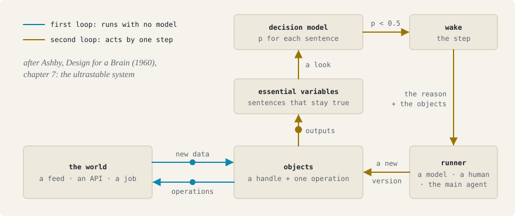
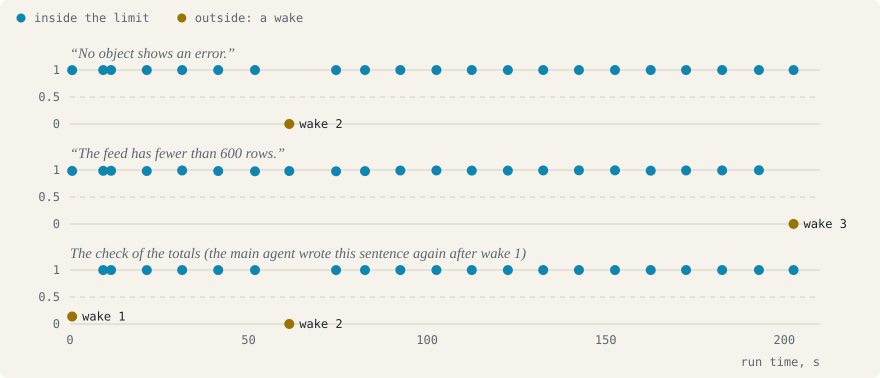
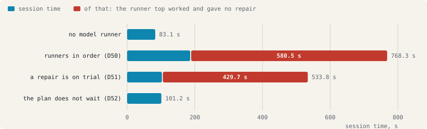
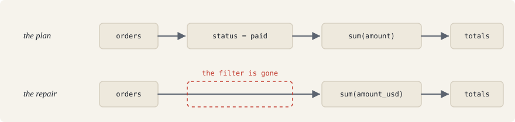
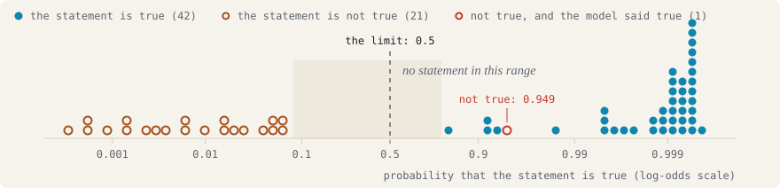

# Uniselector

Uniselector watches the work of an agent, so that the agent does not monitor. The agent builds
objects on [DataHandles](https://github.com/psantillan/datahandles) handles: a filter, an
aggregate, a reading of a stream, a job. It states the essential variables: sentences that are true
while it can sleep. The objects then run with no model. A decision model judges only one thing: is
each essential variable inside its limits? When one is not, Uniselector wakes the agent with the
reason and the objects. The agent replaces the object that is broken, and it sleeps again.

An object can name the runners that repair it, in order: a local model, a larger model, the agent.
Then a wake goes to the runner of the object first, and the agent sleeps through the repair.

It is an implementation of W. Ross Ashby's ultrastable system (*Design for a Brain*, 2nd ed. 1960,
chapter 7; *An Introduction to Cybernetics*, 1956). The name is the Homeostat's uniselector: the
stepping switch that chose a new configuration when a unit's essential variable left its limits.

## How it works

<picture>
  <source media="(prefers-color-scheme: dark)" srcset="docs/figures/two-loops-dark.svg">
  
</picture>

*The first loop runs all the time and uses no model. The second loop reads the outputs. Most looks stop at the decision model, because each sentence is still true. Only a probability below 0.5 goes on to a wake.*

| Ashby | In this system |
| --- | --- |
| Environment | The resources behind the handles: a feed, a room, a service, a script |
| Reacting part R | The objects that the main agent built. DataHandles runs them. No model is in this loop |
| First loop | An object reads its handle again when the handle has a new version |
| Essential variables | The two hard limits, and the sentences that the main agent wrote |
| Second loop | The decision model looks at what the objects show, and judges each sentence |
| Step-function | A wake: the runner of the object that is broken replaces it, and nothing else |
| Uniselector | The runner at a wake: it selects the next configuration. Each object has its own, as each unit of the Homeostat has |
| The good regulator is a model of the system | The state: each object, its operation, its newest output |

A plan is the objects, the variables, optional notes, and optional lower limits:

    {"objects": [{"name": "totals", "handle": "h_...",
                  "operation": {"capability": "dataset.head", "input": {"n": 20}}}],
     "variables": ["The totals object shows a row for each region, with a number in total."]}

The main agent builds each handle with the DataHandles tools before it submits the plan. The plan
has no steps. The object name is the stable interface: at a wake, the main agent writes a new
handle or a new operation behind the same name.

The decision model looks when the output of an object changes. While nothing changes, it looks
after a silence, and the silence doubles after each look. One look is one request: the state, and
one yes-or-no question for each variable. A variable is outside its limits when the probability of
"yes" is below 0.5 (`docs/DECISIONS.md`, D31 and D32).

### An object carries its runners

<picture>
  <source media="(prefers-color-scheme: dark)" srcset="docs/figures/runners-in-order-dark.svg">
  
</picture>

*The runner is a part of the object that can change. The check of the object and the path of a repair stay the same for each runner.*

An object can have a check of its own (`variables`) and an ordered list of `runners`:

    {"name": "totals", "handle": "h_...", "operation": {"capability": "dataset.head", "input": {"n": 20}},
     "variables": ["It shows one row for each region, with a number in total."],
     "runners": ["local", "top"]}

- A runner is `main` (the main agent), `human` (for an action only), or a model runner that the
  configuration names: a chat model with the DataHandles tools.
- When the check of an object is not true, or the object shows an error, the wake goes to the
  current runner of that object. The runner reads the object and its sources, and it writes one
  new version behind the same name.
- A model runner works beside the loop: each other object runs, and the decision model looks.
- A runner that finds no break gives the wake to the main agent (`to_main`): the check of an
  object says only that the object works.
- A variable of the plan has no object. Its wake goes to the main agent at once, also while a
  runner works.
- The next look judges the repair. When the repair did not hold, or the runner gave none, the
  object binds the next runner of its list for one wake. After the last one, the wake comes to
  the main agent, with what each runner tried. When a repair holds, the object binds its first
  runner again.
- A confirmation is the same binding: the runners of an action are `["main", "human"]`, or
  `["human"]` for a capability that only the human can confirm.

No second model routes a wake. The decision check that exists already says which object is not
adequate (`docs/DECISIONS.md`, D40 to D44 and D49 to D52).

The harness enforces two things, because they must hold when a model is wrong:

1. **Hard limits**: a token budget and a wall time, from the configuration. A plan can ask for
   lower limits, never for higher ones.
2. **The action gate**: an action (a capability that writes, reaches outside, and is not
   idempotent) needs a confirmation. The DataHandles runtime enforces it: the orchestrator's
   principal never holds an action.

The first design of this repository put the decision model in the path of each operation. That was
wrong (`docs/FAILURES.md`, F46; `docs/DECISIONS.md`, D29). D1 to D28 and F1 to F45 are the record
of that design.

## Use

    pip install "uniselector @ git+https://github.com/psantillan/uniselector"
    cp uniselector.example.toml uniselector.toml     # state the two hard limits
    uniselector-mcp --config uniselector.toml

The MCP server has four tools:

- `plan_submit(plan)` starts a run and returns a run id.
- `plan_status(run, wait_seconds)` returns a bounded summary: the state, the variables, what each
  object shows now, a pending wake or confirmation, and what to do next. With `wait_seconds`, the
  call waits until the run needs the main agent.
- `plan_answer(run, question, value)` answers a wake. The value has the new version of an object,
  the names of objects to remove, a new list of variables, or `end`. Only what it names changes.
- `plan_confirm(run, request, decision)` approves an action, denies it, or passes it to the human.

A human decides with `uniselector-confirm`. `docs/HOOKS.md` has the hook that shows a pending
request to the user of Claude Code or Codex.

### The models

- **The main agent** is the MCP client. Its model is a setting of that client, not of Uniselector.
- **A model runner** is a `[runners.NAME]` table of the configuration: `url` (a chat completions
  API in the OpenAI form), `model`, `wake_tokens` (the most that one wake can spend), and
  optionally `key_env` and `body` (more keys for each request). An object names it in `runners`.
  Before you name a local model, read the context that its server gives it
  (`docs/FAILURES.md`, F54).
- **The decision model** is in the `[decision]` section of the configuration: `decision_url`,
  `decision_model`, and `decision_key_env` (the name of the environment variable that has the API
  key; the key is in no file). A decision model is a model of its own class: it reads a state and
  typed questions, it gives one probability for each allowed answer, and it writes no text.
  Examples are TypeSafe Jev, Perplexity pplx-decider and Cloudflare Clef. A model behind another
  API replaces it as one callable: `Harness(cfg, decide=...)`.

The threshold 0.5 belongs to the decision model. Run the detector check (below) for a new model
before you use it.

## Measurements

Each row is one run of one task with a real main agent, on 2026-11-16 (UTC). The main agent was
Claude Code in headless mode (`claude-sonnet-5-5`) with only the DataHandles tools and the four
tools above. The decision model was `perplexity/pplx-decider-v1.2` on the Decisions API of
OpenRouter. The hard limits were 400,000 tokens and 1,800 s. `tasks/drive.py` runs a task, changes
the world on a schedule while the main agent works, and checks the answer against a truth that it
computes without a model. The rows are single runs, not a benchmark.

Each cost is a percentage. The base is the cost of the main agent alone on the schema task with
the 60 s feed: 100% is $0.1139, as Claude Code states it. The cost of the decision model is a
percentage of the cost of the main agent in the same run. Each `record.json` of the evidence has
the costs in dollars.

The tasks:

- **schema**: a feed of orders grows. The main agent keeps totals for each region. After 18 s
  (60 s feed) or 60 s (200 s feed), the column `amount` gets the name `amount_usd`.
- **shift**: the same feed. New orders get the status `settled` in place of `paid`.
- **silent**: two temperature sensors. The sensor in use stops, and the other one goes on.
- **goal**: switch a heater on, wait for 26 degrees, switch it off. The heater is an action.
- **goal-human**: the same, with the heater marked human-only.
- **code**: a script that runs for 90 s and prints a checksum.
- **api**: one request that takes 90 s.

| Task | Answer | Session time | Turns of the main agent | Main agent context, first turn to peak | Cost of the main agent, of the base | Looks | Wakes | Operations | Confirmations | Run tokens | Cost of the decision model, of the main agent |
| --- | --- | --- | --- | --- | --- | --- | --- | --- | --- | --- | --- |
| schema, 60 s feed | right | 83.1 s | 15 | 7,793 to 14,275 | 82% | 19 | 2 | 38 | 0 | 11,105 | 0.24% |
| schema, 200 s feed | right | 226.7 s | 18 | 7,793 to 16,122 | 84% | 22 | 3 | 42 | 0 | 12,942 | 0.27% |
| shift | right | 85.6 s | 17 | 7,817 to 16,153 | 89% | 15 | 2 | 38 | 0 | 11,771 | 0.23% |
| silent | right | 135.1 s | 12 | 7,827 to 14,465 | 70% | 54 | 2 | 65 | 0 | 34,233 | 0.86% |
| goal | right | 183.5 s | 11 | 7,737 to 10,947 | 44% | 55 | 1 | 56 | 0 | 21,273 | 0.84% |
| goal-human | right | 197.6 s | 14 | 7,839 to 14,494 | 68% | 58 | 1 | 61 | 2, each one by the human | 25,648 | 0.67% |
| code | right | 107.2 s | 6 | 7,720 to 9,863 | 33% | 6 | 1 | 1 | 0 | 2,345 | 0.13% |
| api | right | 103.1 s | 5 | 7,735 to 9,589 | 30% | 6 | 1 | 1 | 0 | 2,143 | 0.13% |

A look is one request to the decision model. An operation is one run of an object. The run tokens
are the spend against the token budget: the input tokens of the decision model. The two costs come from
the costs that Claude Code and the Decisions API state. The evidence of each row is a directory in
`docs/evidence`, in the order of the table: `schema_20261116_162735`, `schema_20261116_163338`,
`shift_20261116_164133`, `silent_20261116_164259`, `goal_20261116_164515`,
`goal-human_20261116_164819`, `code_20261116_165137`, `api_20261116_165326`.

<picture>
  <source media="(prefers-color-scheme: dark)" srcset="docs/figures/looks-dark.svg">
  
</picture>

*The 22 looks of the run with the 200 s feed (`run_20261116_163355_18ad`). Each row is one sentence, and each dot is the probability that the decision model gave it at one look. Wake 1 had no fault of the feed (F47). Wake 2 is the new column name. Wake 3 is the end of the feed.*

### Baseline: the main agent alone

`tasks/drive.py --direct` gives the main agent the same task and only the DataHandles tools. It
watches the feed itself. Each row is one run.

<picture>
  <source media="(prefers-color-scheme: dark)" srcset="docs/figures/context-dark.svg">
  
</picture>

*The context of the main agent in the two sessions with the 200 s feed. Each step is one model request. Alone: 93 turns. With Uniselector: 18 turns, and 25% of the cost. Each answer was right.*

| Task | Mode | Answer | Session time | Turns of the main agent | Main agent context, first turn to peak | Cost of the main agent, of the base |
| --- | --- | --- | --- | --- | --- | --- |
| schema, 60 s feed | Uniselector | right | 83.1 s | 15 | 7,793 to 14,275 | 82% |
| schema, 60 s feed | alone | right | 69.8 s | 31 | 5,852 to 13,204 | 100% |
| schema, 200 s feed | Uniselector | right | 226.7 s | 18 | 7,793 to 16,122 | 84% |
| schema, 200 s feed | alone | right | 225.3 s | 93 | 5,852 to 26,993 | 341% |

- With Uniselector, the feed that is 3.3 times as long added 3 turns to the main agent, and its cost grew by 3%.
  Alone, it added 62 turns, and the cost grew by 241%: the main agent made 88 `handle_invoke` calls, and each
  answer stayed in its context.

<picture>
  <source media="(prefers-color-scheme: dark)" srcset="docs/figures/longer-wait-dark.svg">
  
</picture>

*The four sessions of the table. Each axis starts at zero.*

- On the 60 s feed the two modes are close. Alone, the main agent was 13 s faster and its context
  stayed smaller. In that baseline the feed also started 16 s earlier in the session (F48).
- Uniselector starts with about 1,900 more tokens of context: the text of its four tools.
- The evidence: `schema-direct_20261116_163205` and `schema-direct_20261116_163736`.
  `schema-direct_20261116_162916` is void: the driver did not start the feed (F48).
- No baseline was run for the other tasks of this design. A baseline of the first design did the
  goal task alone, with the same prompt and the same room: 183.3 s, 86 turns, context 5,796 to
  22,010, and a cost of 284% of the base (`stream-direct_20261116_003123`).

### Model runners

Each row is one run of the schema task with the 60 s feed, on 2026-11-16 (UTC). The main agent
could give an object the runners `local` and `top`. `local` was `qwen3.8-27b` behind vLLM on a
machine of the local network, with 245,760 tokens of context. `top` was
`deepseek/deepseek-v4.1-flash-1017` on OpenRouter. The token budget was 5,000,000. One wake could
spend 2,000,000 tokens (`local`) or 1,000,000 (`top`). The cost of the run is the cost of the
decision model and of `top`, as a percentage of the same base.

| Code | Answer | Session time | Turns of the main agent | Main agent context, first turn to peak | Cost of the main agent, of the base | Outcome of the run | Looks | Wakes | Starts of a model runner | Run tokens | Cost of the run, of the base |
| --- | --- | --- | --- | --- | --- | --- | --- | --- | --- | --- | --- |
| D50 | right | 768.3 s | 16 | 8,471 to 16,014 | 82% | `done` after 734.1 s | 29 | 2 | 3 | 778,229 | 118% |
| D51 | right | 533.8 s | 18 | 8,531 to 18,409 | 99% | `done` after 496.2 s | 29 | 4 | 3 | 553,684 | 79% |
| D52 | right | 101.2 s | 19 | 8,611 to 20,456 | 116% | `done` after 56.1 s | 19 | 4 | 1 | 50,636 | 0.4% |

<picture>
  <source media="(prefers-color-scheme: dark)" srcset="docs/figures/runner-versions-dark.svg">
  
</picture>

*The session time of the three runs, and of the run with no model runner. In the first two runs, the runner `top` worked for 580.5 s and 429.7 s and gave no repair.*

- The first column names the newest decision of `docs/DECISIONS.md` that the code of the run had.
- In the first two runs, the column got its new name, and `local` repaired the object `totals`
  while the main agent slept. The repair took 15.3 s and 27,991 tokens in the first run, and 45.8 s
  and 78,746 tokens in the second one. Each repair held, and its totals were right.
- The first two sessions took 9 to 13 times as long as the feed. With no model runner, the same
  task took 83.1 s (the first table). The cause was not the repair of `totals`. The main agent
  gave a model runner a check that no repair could make true: the goal of the plan (F57), and a
  check for a change of the data (F60). `local` gave no repair that held. `top` then read for
  580 s and 430 s, spent 676,367 and 414,109 tokens, and gave no result (F57, F61). The main
  agent waited for `top` (F62).
- In the third run, a variable of the plan woke the main agent while a runner worked (D52). The
  goal woke the main agent 0.4 s after its object showed the last rows, and the session took
  101.2 s.
- In the third run, the repair of `local` was wrong: it took 18.3 s and 26,706 tokens, and it left
  out the filter on `status`. The check of the object was true for the wrong totals, so the repair
  held (F64). At the next wake, the main agent saw that a runner wrote the object, read it, and
  built it again. So the model runner saved the main agent no work in that run: the main agent
  cost 116% of the base, and 82% in the run with no model runner.
- The evidence, in the order of the table: `schema_20261116_184734`, `schema_20261116_192536`,
  `schema_20261116_195950`.
  `schema_20261116_181501` is the first run with model runners. It used a local model with 4,096
  tokens of context and a budget of 400,000 tokens, and it ended at the budget (F53 to F56).

<picture>
  <source media="(prefers-color-scheme: dark)" srcset="docs/figures/timeline-dark.svg">
  
</picture>

*The third run, second by second (`run_20261116_200008_6843`). Look 7 found the new column name, and that one look gave two wakes: the object went to `local`, and the sentence of the plan went to the main agent.*

<picture>
  <source media="(prefers-color-scheme: dark)" srcset="docs/figures/repair-that-held-dark.svg">
  
</picture>

*The repair of the third run (F64). The check of the object stated the columns of the output and that `total` is a number. No sentence stated the filter, so the decision model had nothing to find.*

`tasks/repair.py` wakes one runner for one broken object, with no main agent: an object counts
the paid orders of a feed, and the column `status` gets the name `state`. Each row is one run.

| Runner | New version of the object | Calls | Tokens | Time |
| --- | --- | --- | --- | --- |
| `qwen3.8-27b`, vLLM, 245,760 tokens of context | right | 7 | 13,992 | 10.1 s |
| `ornith-1.5:9b`, Ollama | right | 7 | 19,242 | 58.3 s |

The evidence: `repair_20261116_184658` and `repair_20261116_181108`.

### Detector check

<picture>
  <source media="(prefers-color-scheme: dark)" srcset="docs/figures/detector-dark.svg">
  
</picture>

*The probability that the decision model gave to each of the 32 statements.*

`tasks/probe.py` gives the decision model 16 small states and 32 statements with a known answer: a
schema error, a row count over a limit, a new status value, a sensor that stopped, a goal that is
met, a job that ended, a quiet object, a check of one object, and the same states with no fault. The model was
right on 32 of 32. It gave 0.9956 to 0.9995 to each true statement and 0.0003 to 0.0493 to each
statement that was not true. The check used 6,006 tokens, at 0.1% of the base. The evidence:
`docs/evidence/probe_20261116_v4`. The states are small and the author of the detector wrote
them, so the check shows that the threshold separates the two cases. It is not a measure of
accuracy.

### What the rows do not show

- The decision model looks at each change of an output. An object that shows each new reading
  gave 54 to 58 looks in the three stream runs, and all but one or two of the looks in each run
  found nothing. At the 387 tokens for each look of the goal run, the budget of 400,000 tokens ends such a run
  after about 50 minutes (F49). An object whose output changes only when the work needs attention
  removes that cost. No run measured it. In one run, the Decisions API refused look 52 with HTTP
  429 (F58). Such a look now stays due, and no run met a busy API after that change.
- A model runner can replace an object that works (F60). In two wakes, the runner `top` spent
  1,090,476 tokens and gave no result (F57, F61). No limit of a wake changed: the token budget
  and the wall time are the limits.
- After a repair that does not hold, the next runner gets the version of that repair, not the
  version that the main agent wrote (`docs/DECISIONS.md`, D52).
- A repair that the check of its object accepts can be wrong: a check rejects only what it states
  (F64). One of the three repairs of the totals by `local` was wrong in this way.
- One wake had no fault: the main agent wrote a variable about columns that its object did not
  show (F47).
- The runs used the code before one change: a long output kept only its first part then. It keeps
  its first and its last part now. A new value in the middle of a long output still does not
  reach the decision model (F50).
- In the goal task with no human-only capability, the main agent switched the heater itself. The
  gate is in the path of the orchestrator only (F52). When only the human's principal holds the
  action, the protocol refuses that call: in `goal-held_20261116_190023` the human approved and
  ran each switch.
- In the api task, the main agent gave its answer at the wake and did not end the run (F51).
- No run made the main agent compact its context, so no run tested a wake into a fresh context.
- `docs/FAILURES.md` has 64 entries. Each one has its evidence and says if it is open.

## Documents

- `docs/DECISIONS.md`: each design decision and its reason.
- `docs/GAPS.md`: what the DataHandles protocol lacks, and the workaround for each gap.
- `docs/FAILURES.md`: each failure of a real run, the part that failed, and the evidence.
- `docs/HOOKS.md`: the hooks, and what each tool's hooks can and cannot see.
- `docs/figures`: the drawings of this page. `results.html` is the page that builds them. It holds the
  numbers of the evidence. `export.py` writes each drawing as a file.

## Development

    python -m venv .venv
    .venv/bin/pip install -e ".[dev]"
    .venv/bin/pip install -e ../datahandles     # optional: a local DataHandles checkout over the pinned commit
    .venv/bin/pytest tests -q

The tests need no model and no key. A decider that follows a script stands in for the decision
model, and a server of the test stands in for the Decisions API. `tests/test_boundary.py`
fails if `uniselector` imports `datahandles.runtime` or `datahandles.core`.

MIT license.
