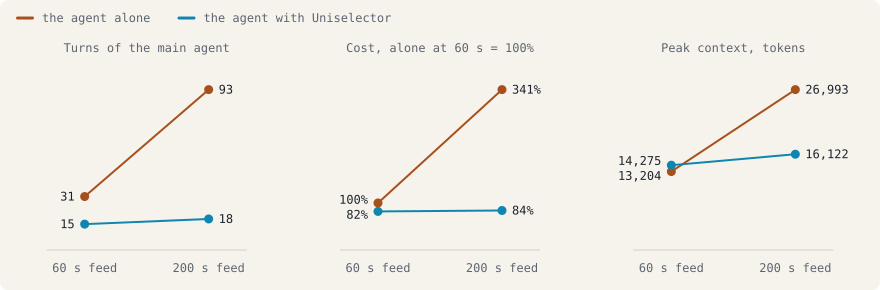

# Uniselector

Uniselector lets a coding agent sleep through long work. The agent builds the objects that do the
work, states what must stay true, and leaves. The objects run with no model. A decision model
watches them, and it wakes the agent only when something breaks, with the reason and the objects.
The agent replaces the object that is broken, and it sleeps again.

<picture>
  <source media="(prefers-color-scheme: dark)" srcset="docs/figures/context-dark.svg">
  
</picture>

*One task, two sessions: keep totals of a feed for 200 s, through a schema break. Alone, the agent used 93 turns. With Uniselector it used 18 turns, at 25% of the cost. Each answer was right.*

- **The agent does not monitor.** It builds the thing that monitors. A feed that is 3.3 times as
  long added 3 turns to the agent. Alone, it added 62.
- **A repair goes to the cheapest runner that can make it.** An object names its runners in order:
  a local model, a larger model, a function of your code, the agent. A free local model repaired a
  schema break with one request in 6 s, while the agent slept.
- **Each repair passes the check of its object.** The check that found the break judges the
  replacement, and a replacement stays only when each sentence is true.
- **The watch is cheap.** The decision model cost 0.13% to 0.86% of the cost of the agent.
- **Two rules are in the harness, not in a model.** A token budget with a wall time, and a confirmation
  for each action. The [DataHandles](https://github.com/psantillan/datahandles) protocol enforces
  the confirmation.

Uniselector is an implementation of W. Ross Ashby's ultrastable system (*Design for a Brain*, 2nd
ed. 1960, chapter 7; *An Introduction to Cybernetics*, 1956). The name is the Homeostat's
uniselector: the stepping switch that chose a new configuration when a unit's essential variable
left its limits.

## Install

    pip install "uniselector @ git+https://github.com/psantillan/uniselector@v0.5.0"

Python 3.11 or newer. The package installs DataHandles 0.4.1 with its DuckDB adapter and its MCP
server.

## Quickstart

1. Copy [`uniselector.example.toml`](uniselector.example.toml) to `uniselector.toml`. State the two
   hard limits and the decision model.
2. Start the MCP server, and add it to your agent beside the DataHandles MCP server:

       uniselector-mcp --config uniselector.toml

3. Give the agent a long task. It builds handles with the DataHandles tools, and it submits a plan:

       {"objects": [{"name": "totals", "handle": "h_...",
                     "operation": {"capability": "dataset.head", "input": {"n": 20}},
                     "variables": ["It shows one row for each region, with a number in total."],
                     "runners": ["local", "top"]}],
        "variables": ["The feed has fewer than 600 rows."]}

The MCP server has four tools:

- `plan_submit(plan)` starts a run and returns a run id.
- `plan_status(run, wait_seconds)` returns a bounded summary: the state, the variables, what each
  object shows now, a pending wake or confirmation, and what to do next. With `wait_seconds`, the
  call waits until the run needs the agent.
- `plan_answer(run, question, value)` answers a wake. The value has the new version of an object,
  the names of objects to remove, a new list of variables, or `end`. Only what it names changes.
- `plan_confirm(run, request, decision)` approves an action, denies it, or passes it to the human.

A human decides with `uniselector-confirm`. [`docs/HOOKS.md`](docs/HOOKS.md) has the hook that
shows a pending request to the user of Claude Code or Codex.

## How it works

<picture>
  <source media="(prefers-color-scheme: dark)" srcset="docs/figures/two-loops-dark.svg">
  
</picture>

*The first loop runs all the time and uses no model. The second loop reads the outputs. Most looks stop at the decision model, because each sentence is still true. Only a probability below 0.5 goes on to a wake.*

| Ashby | In this system |
| --- | --- |
| Environment | The resources behind the handles: a feed, a room, a service, a script |
| Reacting part R | The objects that the agent built. DataHandles runs them. No model is in this loop |
| First loop | An object reads its handle again when the handle has a new version |
| Essential variables | The two hard limits, and the sentences that the agent wrote |
| Second loop | The decision model looks at what the objects show, and judges each sentence |
| Step-function | A wake: the runner of the object that is broken replaces it, and nothing else |
| Uniselector | The runner at a wake: it selects the next configuration. Each object has its own, as each unit of the Homeostat has |
| The good regulator is a model of the system | The state: each object, its operation, its newest output |

**A plan** is the objects, the essential variables, optional notes, and optional lower limits. It
has no steps. An object is a handle and one operation behind a stable name: at a wake, a runner
writes a new handle or a new operation behind the same name.

**A look** is one request to the decision model: the state, and one yes-or-no question for each
variable. The decision model looks when the output of an object changes. While nothing changes, it
looks after a silence, and the silence doubles after each look. A variable is outside its limits
when the probability of "yes" is below 0.5.

**A wake** is one replacement. It goes to the runner of the object that is broken, or to the agent
for a variable of the plan.

### Runners

<picture>
  <source media="(prefers-color-scheme: dark)" srcset="docs/figures/runners-in-order-dark.svg">
  
</picture>

*The runner is a part of the object that can change. The check of the object and the path of a repair stay the same for each runner.*

An object can carry a check of its own (`variables`) and an ordered list of `runners`. A runner is
anything that can do the work:

- `main`: the agent.
- `human`: for the confirmation of an action.
- A model runner: a chat model that the configuration names. It gets one request.
- A function runner: a function of your code that the configuration names, or a function in a
  file that the agent wrote (`FILE.py:NAME`).

The rules are the same for each kind:

- **A runner is silent while each sentence is true.** No runner starts. An object with runners
  costs the same as an object with none.
- **A wake is one replacement.** The current runner of the object writes one new version behind
  the same name. A model runner gets one request with the object, the graph that made its handle,
  and the fault of each operation that fails now. It has no tools and no second turn, so its
  context does not grow.
- **The check names the conditions that matter.** The state shows how the handle of each object is
  made: its filters, its groups, its metrics. So a check can state "It sums only the paid orders.",
  and a replacement with no such filter does not pass.
- **The list is in order.** A replacement stays when it passes the check, and its runner keeps
  the object. If not, the object keeps its version from before and the next runner takes the
  wake. The agent is the last runner.
- **The same check removes an expensive runner.** The state shows the tokens that the runners of
  an object spent, so a check can state "The runners of this object spent less than 20000 tokens."
- **A confirmation is the same binding.** The runners of an action are `["main", "human"]`, or
  `["human"]` for a capability that only the human can confirm.

A runner works beside the loop: each other object runs, and the decision model looks. No second
model routes a wake. The decision check says which object is not adequate.

### Forms

An object can carry forms of its output: a second reading of the same output for the reader of a
wake, such as a summary of a long table or an embedding for a search.

    {"name": "totals", "handle": "h_...", "operation": {"capability": "dataset.head", "input": {"n": 50}},
     "forms": {"summary":   {"runners": ["local", "top"],
                             "variables": ["The summary names one status or more."]},
               "embedding": {"runners": ["embedder"]}}}

- The runner of a form works only when a wake is due, and the wake carries the form. While each
  sentence is true, no form is made.
- A form is a bounded value, or the id of a handle that the runner made. Uniselector has no
  embedding engine and stores no vectors: a function runner writes its vectors where it chooses
  and gives the run a handle.
- The decision model judges the check of a form before the wake. The runner of a form that does
  not pass leaves the list of the form, and the next runner works.

One rule makes a plan easy to watch: **an object shows its essential variable in a small output.**
For the sentence "the table has only the statuses paid, pending and refunded", build one more
object that counts the rows for each status. DataHandles computes it with no model, and the
decision model reads all of it.

### What the harness enforces

1. **Hard limits**: a token budget and a wall time, from the configuration. A plan can ask for
   lower limits, never for higher ones.
2. **The action gate**: an action (a capability that writes, reaches outside, and is not
   idempotent) needs a confirmation. The DataHandles runtime enforces it: the orchestrator's
   principal never holds an action, so no runner can run one.

All other rules are information for the decision model, and it judges them.

## Configuration

- **The agent** is the MCP client. Its model is a setting of that client.
- **The decision model** is in the `[decision]` section: `decision_url`, `decision_model`, and
  `decision_key_env` (the name of the environment variable that has the API key; the key is in no
  file). A decision model reads a state and typed questions, gives one probability for each
  allowed answer, and writes no text. Examples are TypeSafe Jev, Perplexity pplx-decider and
  Cloudflare Clef. A model behind another API replaces it as one callable:
  `Harness(cfg, decide=...)`. `tasks/probe.py` checks a new decision model against 64 statements
  with a known answer.
- **A model runner** is a `[runners.NAME]` table with `url` (a chat completions API in the OpenAI
  form), `model`, and optionally `key_env` and `body` (more keys for each request).
- **A function runner** is a `[runners.NAME]` table with `call`:

      [runners.embedder]
      call = "/home/me/runners.py:embedder"
      directory = "/home/me/vectors"

  Uniselector calls `embedder(client, directory=...)` one time, with the DataHandles client of the
  orchestrator's principal. It returns the runner: a function
  `runner(question, submit, spend, seconds)`. `question` is the wake. `submit(value)` gives the
  repair or the form to the run. `spend(tokens, cost)` counts a spend against the token budget.
  `seconds` is the wall time that the run has left.
- **Code of the agent.** With `plan_callables = true` in the `[code]` section, a plan can name
  `FILE.py:NAME` as a runner, and the agent can write that file one minute before. This code runs
  in the process of Uniselector, so the setting is off until you set it.

## Results

Each number is from a real session: Claude Code in headless mode (`claude-sonnet-5-5`) as the
agent, `perplexity/pplx-decider-v1.2` as the decision model, and a task that changes the world on
a schedule and checks the answer against a truth that it computes with no model. Each cost is a
percentage of one base: the cost of the agent alone on the schema task with the 60 s feed.
[`docs/MEASUREMENTS.md`](docs/MEASUREMENTS.md) has the method, each run with its evidence, and
the known limits.

### Eight tasks, eight right answers

| Task | What happens | Turns of the agent | Cost of the agent | Looks | Wakes | Cost of the decision model, of the agent |
| --- | --- | --- | --- | --- | --- | --- |
| schema, 60 s feed | a column gets a new name | 15 | 82% | 19 | 2 | 0.24% |
| schema, 200 s feed | the same, with a longer feed | 18 | 84% | 22 | 3 | 0.27% |
| shift | new orders get a new status value | 17 | 89% | 15 | 2 | 0.23% |
| silent | the sensor in use stops | 12 | 70% | 54 | 2 | 0.86% |
| goal | switch a heater on, wait for 26 degrees, switch it off | 11 | 44% | 55 | 1 | 0.84% |
| goal-human | the same, and a human confirms each switch | 14 | 68% | 58 | 1 | 0.67% |
| code | a script runs for 90 s | 6 | 33% | 6 | 1 | 0.13% |
| api | one request takes 90 s | 5 | 30% | 6 | 1 | 0.13% |

<picture>
  <source media="(prefers-color-scheme: dark)" srcset="docs/figures/looks-dark.svg">
  
</picture>

*The 22 looks of the run with the 200 s feed. Each row is one sentence, and each dot is the probability that the decision model gave it at one look. A dot below 0.5 is a wake.*

### A longer wait costs the agent almost nothing

| Feed | Mode | Turns of the agent | Agent context at its peak | Cost of the agent |
| --- | --- | --- | --- | --- |
| 60 s | alone | 31 | 13,204 | 100% |
| 60 s | Uniselector | 15 | 14,275 | 82% |
| 200 s | alone | 93 | 26,993 | 341% |
| 200 s | Uniselector | 18 | 16,122 | 84% |

<picture>
  <source media="(prefers-color-scheme: dark)" srcset="docs/figures/longer-wait-dark.svg">
  
</picture>

*The four sessions of the table. Each axis starts at zero.*

### A local model takes the repair

The schema task with the 60 s feed. The agent gave the object `totals` the runners
`["local", "top"]` and a check of four sentences. `local` was `qwen3.8-27b` on a machine of the
local network, at no cost.

| | No runners | `local`, then `top` |
| --- | --- | --- |
| Who repaired the object after the new column name | the agent: 3 turns | `local`: one request, 2,726 tokens, 4.2 s |
| Wakes for the agent | 2: the break, and the end of the feed | 1: the end of the feed |
| From the look that found the break to a good object | 8.1 s | 6.0 s |
| Turns of the agent | 14 | 11 |
| Cost of the agent | 90% | 79% |
| Cost of the run: the decision model and the runners | 0.2% | 0.4% |

<picture>
  <source media="(prefers-color-scheme: dark)" srcset="docs/figures/timeline-dark.svg">
  
</picture>

*The run with the runners, second by second. The local model got the wake of the break. The agent got one wake: the feed had 600 rows.*

### A form reaches the reader of a wake

Two runs watch one feed with the same objects, and orders with a new status come to one region.
One run has a summary form and an embedding form on a table of 18 rows.

- While nothing failed, the two runs used the same 4,597 tokens in 5 looks, and no runner got a
  request.
- The wake with the forms carried this summary by the local model: "Totals by region and status
  (paid, pending, refunded; disputed only in north)." It also carried a handle to a file of
  vectors that a function runner wrote.

### The check tells a right replacement from a wrong one

`tasks/probe.py` gives the decision model 31 states and 64 statements with a known answer. It was
right on 63 of 64, for 14,727 tokens. For a replacement that changed only the name of a column,
"It sums only the paid orders." got 0.999. For a replacement that dropped the filter, it got 0.004.

## Documents

- [`docs/MEASUREMENTS.md`](docs/MEASUREMENTS.md): the method, each run, and the known limits.
- [`ROADMAP.md`](ROADMAP.md): what is built, what is measured, and what is next.
- [`docs/DECISIONS.md`](docs/DECISIONS.md): each design decision and its reason.
- [`docs/FAILURES.md`](docs/FAILURES.md): the failure log of the real runs, with the evidence of each entry.
- [`docs/GAPS.md`](docs/GAPS.md): what the DataHandles protocol lacks, and the workaround for each gap.
- [`docs/HOOKS.md`](docs/HOOKS.md): the hooks for Claude Code and Codex.
- [`docs/evidence`](docs/evidence): the record, the decision log and the session log of each run.
- [`docs/figures`](docs/figures): the drawings of this page, and `export.py`, which writes them.

## Development

    python -m venv .venv
    .venv/bin/pip install -e ".[dev]"
    .venv/bin/pip install -e ../datahandles     # optional: a local DataHandles checkout over the pinned tag
    .venv/bin/pytest tests -q

The tests need no model and no key. A decider that follows a script stands in for the decision
model, and a server of the test stands in for the Decisions API. `tests/test_boundary.py`
fails if `uniselector` imports `datahandles.runtime` or `datahandles.core`.

## License

MIT. See [`LICENSE`](LICENSE).
