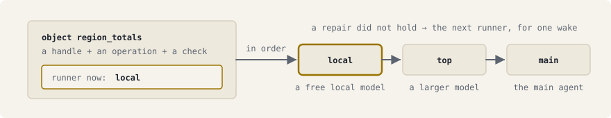
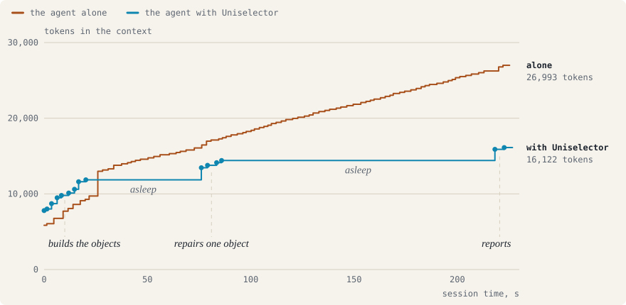
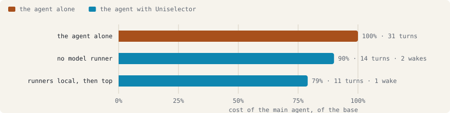
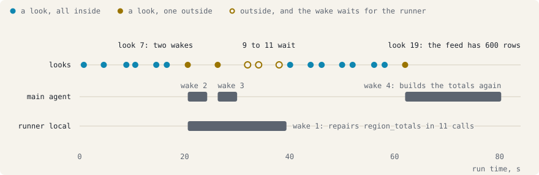
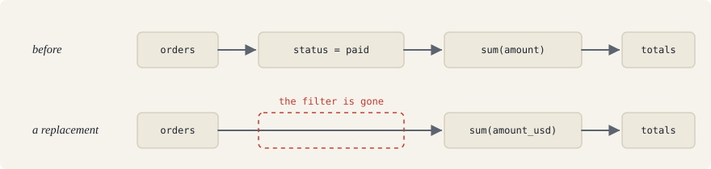

# Uniselector

Uniselector watches the work of an agent, so that the agent does not monitor. The agent builds
objects on [DataHandles](https://github.com/psantillan/datahandles) handles: a filter, an
aggregate, a reading of a stream, a job. It states the essential variables: sentences that are true
while it can sleep. The objects then run with no model. A decision model judges only one thing: is
each essential variable inside its limits? When one is not, Uniselector wakes the agent with the
reason and the objects. The agent replaces the object that is broken, and it sleeps again.

An object can name the runners that replace it when it breaks, in order: a local model, a larger
model, a function of your code, the agent. Then a wake goes to the runner of the object first, and
the agent sleeps through the repair. A runner can also make a form of the output of an object for
the reader of a wake, such as a summary or an embedding. A runner is a part of the object that is
not in use until a variable leaves its limits: while each sentence is true, an object with runners
costs the same as an object with none.

It is an implementation of W. Ross Ashby's ultrastable system (*Design for a Brain*, 2nd ed. 1960,
chapter 7; *An Introduction to Cybernetics*, 1956). The name is the Homeostat's uniselector: the
stepping switch that chose a new configuration when a unit's essential variable left its limits.

## How it works

<picture>
  <source media="(prefers-color-scheme: dark)" srcset="docs/figures/two-loops-dark.svg">
  
</picture>

*The first loop runs all the time and uses no model. The second loop reads the outputs. Most looks stop at the decision model, because each sentence is still true. Only a probability below 0.5 goes on to a wake.*

| Ashby | In this system |
| --- | --- |
| Environment | The resources behind the handles: a feed, a room, a service, a script |
| Reacting part R | The objects that the main agent built. DataHandles runs them. No model is in this loop |
| First loop | An object reads its handle again when the handle has a new version |
| Essential variables | The two hard limits, and the sentences that the main agent wrote |
| Second loop | The decision model looks at what the objects show, and judges each sentence |
| Step-function | A wake: the runner of the object that is broken replaces it, and nothing else |
| Uniselector | The runner at a wake: it selects the next configuration. Each object has its own, as each unit of the Homeostat has |
| The good regulator is a model of the system | The state: each object, its operation, its newest output |

A plan is the objects, the variables, optional notes, and optional lower limits:

    {"objects": [{"name": "totals", "handle": "h_...",
                  "operation": {"capability": "dataset.head", "input": {"n": 20}}}],
     "variables": ["The totals object shows a row for each region, with a number in total."]}

The main agent builds each handle with the DataHandles tools before it submits the plan. The plan
has no steps. The object name is the stable interface: at a wake, the main agent writes a new
handle or a new operation behind the same name.

The decision model looks when the output of an object changes. While nothing changes, it looks
after a silence, and the silence doubles after each look. One look is one request: the state, and
one yes-or-no question for each variable. A variable is outside its limits when the probability of
"yes" is below 0.5 (`docs/DECISIONS.md`, D31 and D32).

### An object carries its runners

<picture>
  <source media="(prefers-color-scheme: dark)" srcset="docs/figures/runners-in-order-dark.svg">
  
</picture>

*The runner is a part of the object that can change. The check of the object and the path of a repair stay the same for each runner.*

An object can have a check of its own (`variables`) and an ordered list of `runners`:

    {"name": "totals", "handle": "h_...", "operation": {"capability": "dataset.head", "input": {"n": 20}},
     "variables": ["It shows one row for each region, with a number in total."],
     "runners": ["local", "top"]}

A runner is anything that can do the work. The run does not know what is behind it:

- `main`: the main agent.
- `human`: for the confirmation of an action only.
- A model runner that the configuration names: a chat model that gets one request.
- A function runner: a function of your code that the configuration names, or a function in a
  file that the main agent wrote (`FILE.py:NAME`).

The rules are the same for each kind:

- **A runner is silent while each sentence is true.** No runner starts, and the decision model
  gets the same text and the same questions as for an object with no runners.
- **A wake is one replacement.** When the check of an object is not true, or the object shows an
  error, the wake goes to the current runner of that object. The runner writes one new version
  behind the same name. A model runner gets one request with the object, the graph that made its
  handle, and the fault of each operation that fails now. Its answer names the operations that
  change. It has no tools and no second turn, so its context does not grow.
- **The check names the conditions that matter.** The state shows how the handle of each object is
  made: its filters, its groups, its metrics. So a check can state "It sums only the paid orders.",
  and a replacement with no such filter does not pass. A check rejects only what it states. At the
  look that judges a replacement by a runner, the run adds one sentence to the check: the handle is
  made by the same operations as before: the same filters, the same groups and the same metrics.
  Only the name of a column can differ.
- **A runner that fails leaves the list.** When the replacement does not hold, or the runner gave
  none, the runner leaves the list of the object, and the next runner gets the wake. A replacement
  that does not hold leaves with its runner: the object gets back the version from before, so the
  next runner reads the break that the first one read. After the last runner, the wake comes to
  the main agent, with what each runner tried. A replacement that holds keeps its runner.
- **The same check removes an expensive runner.** The state shows the tokens that the runners of
  an object spent. A check can state a limit: "The runners of this object spent less than 20000
  tokens."
- A runner works beside the loop: each other object runs, and the decision model looks.
- A runner that finds no break gives the wake to the main agent (`to_main`), and it stays in the
  list: the check of an object says only that the object works.
- A variable of the plan has no object. Its wake goes to the main agent at once, also while a
  runner works.
- A confirmation is the same binding: the runners of an action are `["main", "human"]`, or
  `["human"]` for a capability that only the human can confirm.

No second model routes a wake. The decision check says which object is not adequate
(`docs/DECISIONS.md`, D40 to D44, D51 to D53, D55 to D59 and D61).

### A form of an output

An object can carry forms of its output. A form is a second reading of the same output for a
reader that cannot use the output as it is: a summary of a long table, an embedding for a search.
Each form has its own ordered list of runners and an optional check:

    {"name": "totals", "handle": "h_...", "operation": {"capability": "dataset.head", "input": {"n": 50}},
     "forms": {"summary":   {"runners": ["local", "top"],
                             "variables": ["The summary names one status or more."]},
               "embedding": {"runners": ["embedder"]}}}

- The runner of a form works only when a wake is due. The wake waits for the forms of the objects
  that it shows, so the runner of the object or the main agent reads them with the wake. While
  each sentence is true, no form is made.
- A form is a bounded value, or the id of a handle that the runner made. The output stays an
  ordinary handle. Uniselector has no embedding engine and stores no vectors: a function runner
  writes its vectors where it chooses and gives the run a handle.
- The decision model judges the check of a form at the look before the wake. The runner of a form
  that does not pass leaves the list of the form, and the next runner works. After the last one,
  the wake goes with no form.
- An object with no `forms` makes no form, and no runner starts.

A form is for the reader of a wake. It does not help the decision model to find a failure. The
state keeps only the first part and the last part of a long output, so a value in the middle of a
long table does not reach the decision model. The rule for a plan: **an object shows its
essential variable in a small output.** For the sentence "the table has only the statuses paid,
pending and refunded", build one more object that counts the rows for each status. DataHandles
computes it with no model, and the decision model reads all of it (`docs/DECISIONS.md`, D54 and
D58).

### What the harness enforces

The harness enforces two things, because they must hold when a model is wrong:

1. **Hard limits**: a token budget and a wall time, from the configuration. A plan can ask for
   lower limits, never for higher ones.
2. **The action gate**: an action (a capability that writes, reaches outside, and is not
   idempotent) needs a confirmation. The DataHandles runtime enforces it: the orchestrator's
   principal never holds an action, so no runner can run one.

## Install

    pip install "uniselector @ git+https://github.com/psantillan/uniselector@v0.5.0"

Python 3.11 or newer. The package installs DataHandles 0.4.1 with its DuckDB adapter and its MCP
server.

## Use

Copy [`uniselector.example.toml`](uniselector.example.toml) to `uniselector.toml`, state the two
hard limits, and start the MCP server:

    uniselector-mcp --config uniselector.toml

The MCP server has four tools:

- `plan_submit(plan)` starts a run and returns a run id.
- `plan_status(run, wait_seconds)` returns a bounded summary: the state, the variables, what each
  object shows now, a pending wake or confirmation, and what to do next. With `wait_seconds`, the
  call waits until the run needs the main agent.
- `plan_answer(run, question, value)` answers a wake. The value has the new version of an object,
  the names of objects to remove, a new list of variables, or `end`. Only what it names changes.
- `plan_confirm(run, request, decision)` approves an action, denies it, or passes it to the human.

A human decides with `uniselector-confirm`. `docs/HOOKS.md` has the hook that shows a pending
request to the user of Claude Code or Codex.

### The models and the runners

- **The main agent** is the MCP client. Its model is a setting of that client, not of Uniselector.
- **The decision model** is in the `[decision]` section of the configuration: `decision_url`,
  `decision_model`, and `decision_key_env` (the name of the environment variable that has the API
  key; the key is in no file). A decision model is a model of its own class: it reads a state and
  typed questions, it gives one probability for each allowed answer, and it writes no text.
  Examples are TypeSafe Jev, Perplexity pplx-decider and Cloudflare Clef. A model behind another
  API replaces it as one callable: `Harness(cfg, decide=...)`. The threshold 0.5 belongs to the
  decision model. Run the detector check (below) for a new model before you use it.
- **A model runner** is a `[runners.NAME]` table with `url` (a chat completions API in the OpenAI
  form), `model`, and optionally `key_env` and `body` (more keys for each request). One wake is
  one request, so it has no limit of its own. Before you name a local model, read the context that
  its server gives it (`docs/FAILURES.md`, F54).
- **A function runner** is a `[runners.NAME]` table with `call`:

      [runners.embedder]
      call = "/home/me/runners.py:embedder"
      directory = "/home/me/vectors"

  Uniselector calls `embedder(client, directory=...)` one time, with the DataHandles client of the
  orchestrator's principal. It returns the runner: a function
  `runner(question, submit, spend, seconds)`. `question` is the wake. `submit(value)` gives the
  repair or the form to the run, and it returns a fault as a text when the run does not take the
  value. `spend(tokens, cost)` counts a spend against the token budget. `seconds` is the wall time
  that the run has left.
- **Code of the main agent.** With `plan_callables = true` in the `[code]` section, a plan can
  name `FILE.py:NAME` as a runner, and the main agent can write that file one minute before. The
  default is false: this code runs in the process of Uniselector, and the action gate is not a
  sandbox for code. The user decides.

## Measurements

Each row is one run of one task with a real main agent, on 2026-11-16 (UTC). The main agent was
Claude Code in headless mode (`claude-sonnet-5-5`) with only the DataHandles tools and the four
tools above. The decision model was `perplexity/pplx-decider-v1.2` on the Decisions API of
OpenRouter. The hard limits were 400,000 tokens and 1,800 s. The runs with model runners had a
limit of 5,000,000 tokens. `tasks/drive.py` runs a task, changes the world on a schedule while the
main agent works, and checks the answer against a truth that it computes without a model. The rows
are single runs, not a benchmark.

Each cost is a percentage. The base is the cost of the main agent alone on the schema task with
the 60 s feed: 100% is $0.1139, as Claude Code states it. The cost of the decision model is a
percentage of the cost of the main agent in the same run. Each `record.json` of the evidence has
the costs in dollars.

The tasks:

- **schema**: a feed of orders grows. The main agent keeps totals for each region. After 18 s
  (60 s feed) or 60 s (200 s feed), the column `amount` gets the name `amount_usd`.
- **shift**: the same feed. New orders get the status `settled` in place of `paid`.
- **silent**: two temperature sensors. The sensor in use stops, and the other one goes on.
- **goal**: switch a heater on, wait for 26 degrees, switch it off. The heater is an action.
- **goal-human**: the same, with the heater marked human-only.
- **code**: a script that runs for 90 s and prints a checksum.
- **api**: one request that takes 90 s.

| Task | Answer | Session time | Turns of the main agent | Main agent context, first turn to peak | Cost of the main agent, of the base | Looks | Wakes | Operations | Confirmations | Run tokens | Cost of the decision model, of the main agent |
| --- | --- | --- | --- | --- | --- | --- | --- | --- | --- | --- | --- |
| schema, 60 s feed | right | 83.1 s | 15 | 7,793 to 14,275 | 82% | 19 | 2 | 38 | 0 | 11,105 | 0.24% |
| schema, 200 s feed | right | 226.7 s | 18 | 7,793 to 16,122 | 84% | 22 | 3 | 42 | 0 | 12,942 | 0.27% |
| shift | right | 85.6 s | 17 | 7,817 to 16,153 | 89% | 15 | 2 | 38 | 0 | 11,771 | 0.23% |
| silent | right | 135.1 s | 12 | 7,827 to 14,465 | 70% | 54 | 2 | 65 | 0 | 34,233 | 0.86% |
| goal | right | 183.5 s | 11 | 7,737 to 10,947 | 44% | 55 | 1 | 56 | 0 | 21,273 | 0.84% |
| goal-human | right | 197.6 s | 14 | 7,839 to 14,494 | 68% | 58 | 1 | 61 | 2, each one by the human | 25,648 | 0.67% |
| code | right | 107.2 s | 6 | 7,720 to 9,863 | 33% | 6 | 1 | 1 | 0 | 2,345 | 0.13% |
| api | right | 103.1 s | 5 | 7,735 to 9,589 | 30% | 6 | 1 | 1 | 0 | 2,143 | 0.13% |

A look is one request to the decision model. An operation is one run of an object. The run tokens
are the spend against the token budget: the input tokens of the decision model. The two costs come from
the costs that Claude Code and the Decisions API state. The evidence of each row is a directory in
`docs/evidence`, in the order of the table: `schema_20261116_162735`, `schema_20261116_163338`,
`shift_20261116_164133`, `silent_20261116_164259`, `goal_20261116_164515`,
`goal-human_20261116_164819`, `code_20261116_165137`, `api_20261116_165326`.

<picture>
  <source media="(prefers-color-scheme: dark)" srcset="docs/figures/looks-dark.svg">
  
</picture>

*The 22 looks of the run with the 200 s feed (`run_20261116_163355_18ad`). Each row is one sentence, and each dot is the probability that the decision model gave it at one look. Wake 1 had no fault of the feed (F47). Wake 2 is the new column name. Wake 3 is the end of the feed.*

### The main agent alone

`tasks/drive.py --direct` gives the main agent the same task and only the DataHandles tools. It
watches the feed itself. Each row is one run.

<picture>
  <source media="(prefers-color-scheme: dark)" srcset="docs/figures/context-dark.svg">
  
</picture>

*The context of the main agent in the two sessions with the 200 s feed. Each step is one model request. Alone: 93 turns. With Uniselector: 18 turns, and 25% of the cost. Each answer was right.*

| Task | Mode | Answer | Session time | Turns of the main agent | Main agent context, first turn to peak | Cost of the main agent, of the base |
| --- | --- | --- | --- | --- | --- | --- |
| schema, 60 s feed | Uniselector | right | 83.1 s | 15 | 7,793 to 14,275 | 82% |
| schema, 60 s feed | alone | right | 69.8 s | 31 | 5,852 to 13,204 | 100% |
| schema, 200 s feed | Uniselector | right | 226.7 s | 18 | 7,793 to 16,122 | 84% |
| schema, 200 s feed | alone | right | 225.3 s | 93 | 5,852 to 26,993 | 341% |

- With Uniselector, the feed that is 3.3 times as long added 3 turns to the main agent, and its cost grew by 3%.
  Alone, it added 62 turns, and the cost grew by 241%: the main agent made 88 `handle_invoke` calls, and each
  answer stayed in its context.

<picture>
  <source media="(prefers-color-scheme: dark)" srcset="docs/figures/longer-wait-dark.svg">
  
</picture>

*The four sessions of the table. Each axis starts at zero.*

- On the 60 s feed the two modes are close. Alone, the main agent was 13 s faster and its context
  stayed smaller. In that baseline the feed also started 16 s earlier in the session (F48).
- Uniselector starts with about 1,900 more tokens of context: the text of its four tools.
- The evidence: `schema-direct_20261116_163205` and `schema-direct_20261116_163736`.
- The other tasks have no baseline.

### Model runners

The cost of the main agent is one signal. It is not the grade of a runner binding. A binding is
good when it moves work off the main agent and each variable stays inside its limits. So the grade
has three questions (`docs/DECISIONS.md`, D62):

1. Can the main agent define the runners of an object, and bind them again?
2. Does the main agent sleep while a runner works?
3. Does the check still find a real failure, also when a runner makes it?

**The main agent defines the runners.** In the second run of the table below, the main agent gave
the object `totals` the runners `["local", "top"]` and a check of four sentences. The text of the
tools was its only guide. In an earlier run, the main agent wrote an object again at a wake, with
a new check and the same list (`schema_20261116_233410`). In the goal task, the main agent bound
the human as the runner of one confirmation (`goal-pass_20261116_190342`). No live run has a main
agent that writes its own function runner: `plan_callables` is false by default, and a test covers
that path.

**The main agent sleeps while the runner works.** The schema task with the 60 s feed, with and
with no model runners, on 2026-11-16 and 2026-11-17 (UTC). `local` was `qwen3.8-27b` behind vLLM
on a machine of the local network, with 245,760 tokens of context. `top` was
`deepseek/deepseek-v4.1-flash-1017` on OpenRouter. The token budget was 5,000,000. The cost of the
run is the cost of the decision model and of `top`, as a percentage of the same base. Each column
is one run.

| | No runners | `local`, then `top` |
| --- | --- | --- |
| Answer | right | right |
| Who repaired the object after the new column name | the main agent: 3 turns | `local`: one request, 2,726 tokens, 4.2 s |
| Wakes for the main agent | 2: the break, and the end of the feed | 1: the end of the feed |
| From the look that found the break to the look that found the object good | 8.1 s | 6.0 s |
| Turns of the main agent | 14 | 11 |
| Main agent context, first turn to peak | 10,166 to 16,947 | 10,237 to 15,360 |
| Cost of the main agent, of the base | 90% | 79% |
| Session time | 84.2 s | 87.7 s |
| Looks | 19 | 21 |
| Run tokens | 12,461 | 24,623 |
| Cost of the run, of the base | 0.2% | 0.4% |

The repair moved off the main agent: one wake, 3 turns, and 11% of the base. The local model has
no cost. The run tokens are two times as many, and the cost of the run grew by 0.2% of the base.
The session was 3.5 s longer. The evidence: `schema_20261117_004251` and `schema_20261116_233942`.

<picture>
  <source media="(prefers-color-scheme: dark)" srcset="docs/figures/sessions-dark.svg">
  
</picture>

*Three sessions of the schema task with the 60 s feed. Each answer was right. Each bar is one run.*

<picture>
  <source media="(prefers-color-scheme: dark)" srcset="docs/figures/timeline-dark.svg">
  
</picture>

*The run with model runners, second by second (`run_20261116_234001_c7c7`). The local model got the wake of the break. The main agent got one wake: the feed had 600 rows.*

**The check finds a real failure.** `tasks/repair.py` wakes the runners of one broken object,
with no main agent: an object counts the paid orders of a feed, and the column `status` gets the
name `state`. The check of the object has two sentences: "It shows a count of rows: a number that
is more than 0." and "It counts only the paid orders." Each column is one run.

| | One runner: `qwen3.8-27b` | Two runners: a careless script, then `qwen3.8-27b` |
| --- | --- | --- |
| Requests of a runner before the break | 0 | 0 |
| The first replacement | the filter `state = paid`: right | the filter `amount > 0`: a count and no error, and wrong |
| The look that judged it | each sentence true | "It counts only the paid orders." got 0.054 |
| After that look | the replacement stays | the script leaves the list, and the object has its version from before |
| The second replacement | none | `qwen3.8-27b`, one request of 2,380 tokens: right |
| From the break to a right count | 6.5 s | 12.5 s |
| Wakes for a main agent | 0 | 0 |
| Looks | 7 | 9 |
| Run tokens | 6,940 | 8,690 |

The careless script is a function runner with no model. Its replacement did not hold, so it left
with its runner, and the next runner read the same break and what the script tried. The evidence:
`repair_20261116_232124` and `repair_20261117_002143`.

<picture>
  <source media="(prefers-color-scheme: dark)" srcset="docs/figures/replacement-check-dark.svg">
  
</picture>

*A state of the detector check: a replacement that drops the filter. For a replacement that changed only the name of a column, the decision model gave 0.999 to each of the two sentences.*

The weak points:

- A check rejects only what it states. In a run with no sentence about the filter, a replacement
  with no filter held (`docs/FAILURES.md`, F64).
- The sentence that a look adds for a replacement got 0.949 for the careless replacement. Only the
  sentence of the check that names the condition rejected it (F72).
- A check that names a column rejects the right replacement after the column gets a new name. In
  one run the main agent then got 5 wakes and cost 132% of the base (`schema_20261116_233410`,
  F67 to F69).

### Forms

`tasks/forms.py` has no main agent. Two runs watch one feed of orders with the same two objects.
The object `totals` shows the total for each region and each status: 18 rows, more than the state
keeps. The object `statuses` shows the count of each status. The two runs have the same variable:
"The table of the object `statuses` has only the statuses paid, pending and refunded." One run
has `totals` with no forms. The other run has two forms of `totals`: a summary by the runner
`local` (`qwen3.8-27b`), and an embedding by a function of the task. The feed gets orders with the
known statuses four times. Then five orders with the status `disputed` come to the region north.
Each column is one run.

| | No forms | A summary form and an embedding form |
| --- | --- | --- |
| While nothing failed: looks | 5 | 5 |
| While nothing failed: tokens of the decision model | 4,597 | 4,597 |
| While nothing failed: requests of a runner | 0 | 0 |
| Time from the new status to the wake | 3.0 s | 6.0 s |
| Looks | 6 | 7 |
| Tokens of the decision model | 5,528 | 6,650 |
| Requests of the runner `local` | 0 | 1: 2,015 tokens, 2.6 s |
| Cost of the run, of the base | 0.1% | 0.1% |

- A form cost nothing while nothing failed: each look of the two runs had the same text and the
  same questions.
- The two runs woke for the same variable. The wake with the forms came 3.0 s later, and it
  carried the summary and a handle to a file of vectors.
- The summary said: "Totals by region and status (paid, pending, refunded; disputed only in
  north)." A main agent that gets this wake knows the region with no more reading.
- The function wrote one vector for each of the 19 rows to a file, in 0.1 s. The vectors come
  from a hash of words: the run checks the binding, not an embedding engine.
- The evidence: `forms_20261116_233244`.

### Detector check

<picture>
  <source media="(prefers-color-scheme: dark)" srcset="docs/figures/detector-dark.svg">
  
</picture>

*The probability that the decision model gave to each of the 64 statements.*

`tasks/probe.py` gives the decision model 31 states and 64 statements with a known answer: a
schema error, a row count over a limit, a new status value, a sensor that stopped, a goal that is
met, a job that ended, a quiet object, a check of one object, a form of a long output, a handle
with and with no filter, a replacement that keeps, drops or changes a filter, a group or a metric,
the spend of the runners, and the same states with no fault. The model was right on 63 of 64. It
gave 0.8238 to 0.9996 to each true statement and 0.0003 to 0.0643 to each statement that was not
true, but for one.

The one wrong answer is the sentence that a look adds for a replacement by a runner ("made by the
same operations as the version before it"). The state is the state of a look of a real run: a
runner replaced the filter `status = paid` with the filter `amount > 0`. The model gave that
sentence 0.9489. In the same look, it gave 0.0543 to the sentence of the check "It counts only the
paid orders.", so the run rejected the replacement (`docs/FAILURES.md`, F72). In a smaller state,
the model gave the same sentence 0.0097 for the same kind of replacement.

The check used 14,727 tokens, at 0.3% of the base. The evidence: `docs/evidence/probe_20261117`.
The author of the detector wrote all states but one, and they are small. So the check shows where
the threshold separates the two cases and where it does not. It is not a measure of accuracy.

## Limits

- Each measurement is one run. Nothing here is a benchmark.
- One pair of runs shows that a model runner takes a repair off the main agent (the table above).
  No second run shows how much two equal sessions differ. The main agent is fast on this task: its
  repair took 6.1 s. No run measured a task where the repair is frequent or needs much reading.
- A runner is a gain only with a check that states meaning. A check that names a column rejects
  the right replacement after the column gets a new name, and the main agent then gets more wakes
  than with no runner (F67). Only the text of the tools guides the main agent to such a check
  (`docs/DECISIONS.md`, D60).
- No live run has a main agent that writes its own function runner. `plan_callables` is false by
  default.
- A check rejects only what it states. The sentence that a look adds for a replacement by a
  runner compares the operations of the two versions as text. It does not run the two versions on
  the same data (D56).
- A model runner changes operations of the graph that made the handle. A break that needs a new
  step goes to the next runner or to the main agent (D57).
- A model runner can replace an object that works, when its check is not true for another reason
  (F60).
- A replacement that does not hold shows until the look that judges it: 0.5 s in one run. Then
  the object has its version from before (D61).
- The sentence that a look adds for a replacement by a runner is not a guard alone. In one run it
  got 0.949 for a replacement with another filter. The sentence of the check that names the
  condition rejected that replacement (F72).
- One look can wake a runner and the main agent for the same break, when the plan states the
  check of an object again as a variable of the plan (F69).
- A wake with forms comes later than a wake with none, by the time of the runners of the forms
  (D58).
- A value that is only in the part of a long output that the state does not keep does not reach
  the decision model. The plan needs a small object that shows it (F50).
- The run cannot stop a function runner that does not return (D53).
- The decision model looks at each change of an output. An object that shows each new reading
  gave 54 to 58 looks in the three stream runs, and all but one or two of the looks in each run
  found nothing. At the 387 tokens for each look of the goal run, a budget of 400,000 tokens ends
  such a run after about 50 minutes (F49). An object whose output changes only when the work needs
  attention removes that cost. No run measured it.
- A busy Decisions API makes no look, and the look stays due. A test covers this. One run met a
  busy API (F58).
- A sentence of the main agent that is not true at the start gives a wake with no fault (F47,
  F68).
- When the main agent's principal holds an action, the main agent can invoke it with the
  DataHandles tools, outside the gate: the gate is in the path of the orchestrator (F52). When
  only the human's principal holds the action, the protocol refuses that call: in
  `goal-held_20261116_190023` the human approved and ran each switch.
- In the api task, the main agent gave its answer at the wake and did not end the run (F51).
- No run made the main agent compact its context, so no run tested a wake into a fresh context.
- `docs/FAILURES.md` has 72 entries. Each one has its evidence and says if it is open.

## Documents

- [`ROADMAP.md`](ROADMAP.md): what is built, what is measured, what is next, and the known limits.
- [`docs/DECISIONS.md`](docs/DECISIONS.md): each design decision and its reason.
- [`docs/GAPS.md`](docs/GAPS.md): what the DataHandles protocol lacks, and the workaround for each gap.
- [`docs/FAILURES.md`](docs/FAILURES.md): each failure of a real run, the part that failed, and the evidence.
- [`docs/HOOKS.md`](docs/HOOKS.md): the hooks, and what each tool's hooks can and cannot see.
- [`docs/evidence`](docs/evidence): the record, the decision log and the session log of each run. The address of the
  local model server and the paths of the test machine are replaced with neutral names.
- [`docs/figures`](docs/figures): the drawings of this page. `results.html` is the page that builds them. It holds the
  numbers of the evidence. `export.py` writes each drawing as a file.

## Development

    python -m venv .venv
    .venv/bin/pip install -e ".[dev]"
    .venv/bin/pip install -e ../datahandles     # optional: a local DataHandles checkout over the pinned tag
    .venv/bin/pytest tests -q

The tests need no model and no key. A decider that follows a script stands in for the decision
model, and a server of the test stands in for the Decisions API. `tests/test_boundary.py`
fails if `uniselector` imports `datahandles.runtime` or `datahandles.core`.

## License

MIT. See [`LICENSE`](LICENSE).
